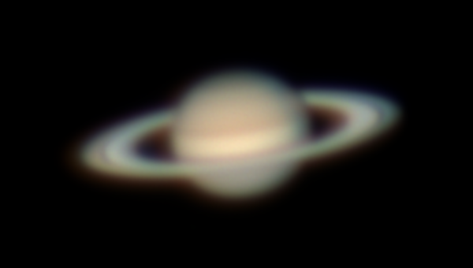
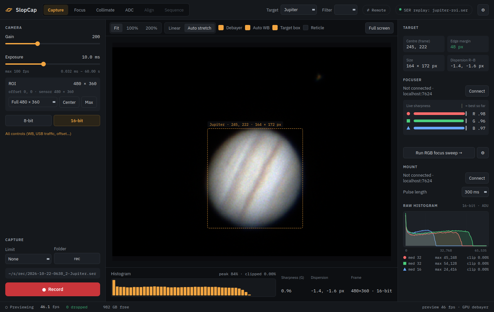
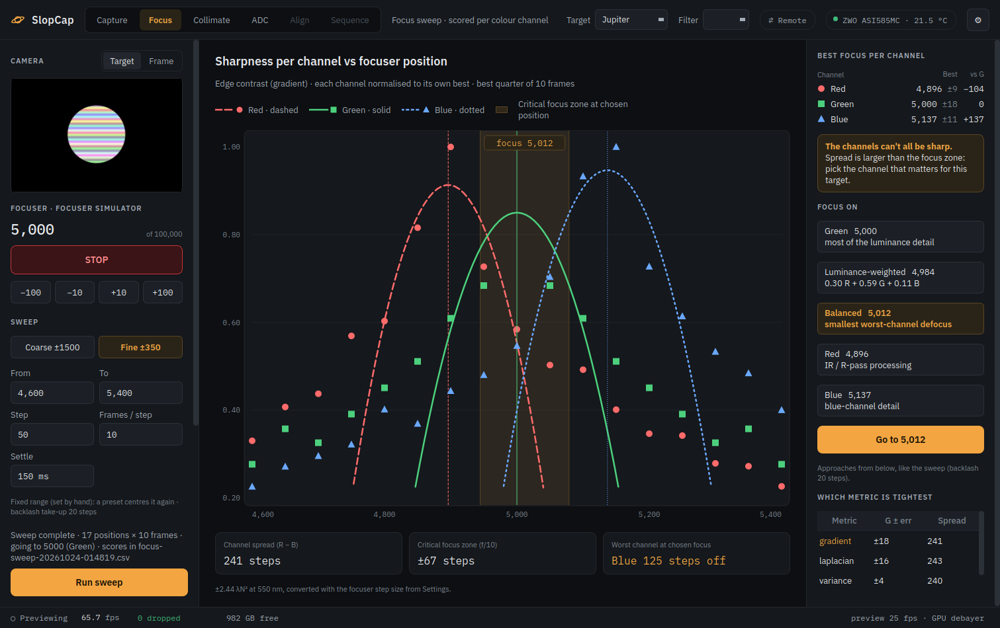
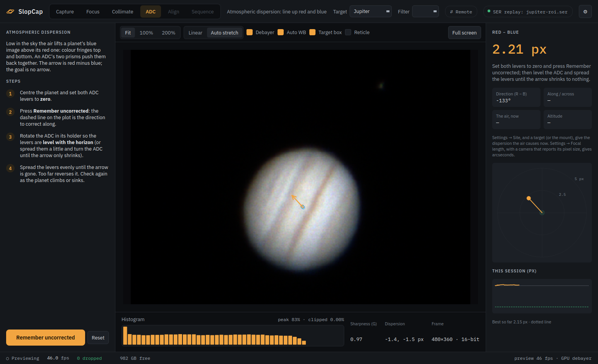
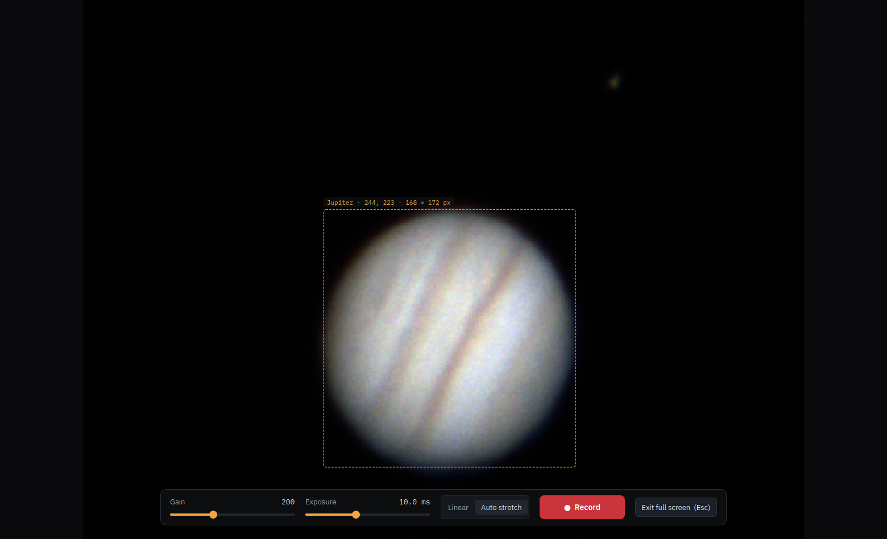

# SlopCap

**SlopCap records video of the planets, the Moon and the Sun** from ZWO, QHY, Player One, ToupTek and MallinCam
astronomy cameras, on Windows, Linux and macOS. It gets every frame onto the disk, shows a live picture that keeps up,
and helps with everything that decides how sharp the result will be: collimation, focus for each colour, atmospheric
dispersion, and knowing what you're pointed at. Its recordings go straight into AutoStakkert!, PIPP and WinJUPOS. It can
also send the camera's picture to other computers on the network, point to point, for a projector at an outreach night
or a warm room indoors.

Saturn above: 5,000 frames of 6.7 ms from a ZWO ASI585MC on 4 August 2022 at 07:03 UT, the best 25 % stacked in
AutoStakkert! and lightly sharpened. It was recorded before SlopCap existed; the Jupiter in the screenshots below is a
recording from the same summer, replayed through SlopCap as if it were the camera.

## What it does

- **Records every frame.** Frames go from the camera into memory set aside in advance and on to the disk without
  waiting on each other. Should anything fall behind, SlopCap counts what the camera lost and what the disk lost,
  separately, and shows it. A ZWO camera has been recorded at 168 frames a second with nothing dropped, on Linux
  and on Windows.
- **A live picture that keeps up**, colour-corrected and stretched on the graphics card, with a histogram, the
  camera's raw readout per colour channel, and the sharpness and dispersion of the planet as you watch.
  Right-click the planet to centre the region of interest on it.
- **Gain at the camera's sweet spots:** buttons for unity gain, lowest read noise and the high-conversion-gain switch,
  from what the camera itself reports.
- **Names recordings the way WinJUPOS expects** (`2022-08-04-0702_8-Saturn.ser`, from the time at the middle of the
  recording), with a text file of every setting next to each. Leave the target on **Auto** and SlopCap works out
  whether it's looking at the Moon, Mars, Jupiter, Saturn, Uranus or Neptune from the image and the clock.
- **Collimation** on a defocused star: it measures how far the secondary's shadow sits from the ring's centre and
  points the way to turn.
- **Focus, colour by colour**, with an electronic focuser, below.
- **ADC:** with an atmospheric dispersion corrector, it measures how far the planet's red and blue images sit apart
  and says which way to move the levers.
- **The mount:** nudge the planet back into the frame with guide pulses, through INDI or with SlopCap's own drivers
  for the common mounts, below.
- **Point-to-point video** to other computers, below.
- **A log of the night:** every setting, recording, drop, focuser move and decision, for working out afterwards what
  happened.

## Focus, colour by colour

Through a Barlow lens, an ADC or any other glass in the light path, red, green and blue light don't come to focus in
quite the same place. On a colour camera that means one focuser position can't be perfect for all three, and judging
focus by eye on the combined picture mostly judges green. SlopCap scores each colour on its own.

**Live:** three bars (red, green, blue) show each colour's sharpness as you turn the focuser, against the best that
colour has reached so far, smoothed over the last few frames so the seeing doesn't make them jump.

**The sweep** finds each colour's best position. Pick a range (Coarse ±1500 or Fine ±350 steps around where the
focuser is, following it as it moves, or your own), a step size and how many frames to take at each step. SlopCap
moves the focuser through the range, always finishing each move in the same direction so the focuser's slack is taken
up the same way every time, waits for it to settle, and scores every frame. Started off to one side of focus, it
doesn't stop at the end of the range with the curve still climbing: it carries on past that end until the curve comes
down again, then goes to the best focus. The camera stays in view beside the chart, and on the other tabs the curves
fill in over a corner of the live preview.

- **Four sharpness measures** on the same frames: edge contrast, fine detail, contrast, and Fourier mid-band
  frequencies. They react differently to seeing and to the planet's detail; **Which metric is tightest** shows which one
  agreed with itself best on this sweep, and you can switch the chart to any of them.
- **The best quarter of the frames** at each position counts, the moments of good seeing, not the average blur.
- **A curve per colour**, fitted near its peak, gives each colour's best position with an error.
- **The critical focus zone**, from the telescope's focal ratio and the focuser's step size in Settings: how far from
  perfect focus you can be before it shows (±2.44 λN²). SlopCap says whether all three colours fit inside it, or that
  they can't all be sharp and you have to choose.

**Then choose what to focus on**, and **Go to** moves there with the same final approach as the sweep:

| Focus on | Position | When |
|---|---|---|
| **Green** | green's best | most of the luminance detail is in green |
| **Luminance-weighted** | 0.30 red + 0.59 green + 0.11 blue | the detail your eye and most processing see |
| **Balanced** | where the worst colour loses least | all three colours as even as they can be |
| **Red** | red's best | infrared or red-filtered work, Mars |
| **Blue** | blue's best | blue-channel detail |

Every sweep's scores, frame by frame, are saved as a CSV next to the recordings.

The screenshot shows a sweep against INDI's focuser simulator, with a test camera whose red, green and blue are
sharpest at different positions.

## Line up the colours

Low in the sky the air acts as a weak prism: it lifts a planet's blue image a little above its red one and smears the
detail. With an atmospheric dispersion corrector (ADC) between the telescope and the camera, the **ADC** tab measures
how far red sits from blue, live and to a fraction of a pixel, and says what to do next: spread the levers, close them,
or turn the ADC itself. Knowing the site and the target, it also shows how much dispersion the air is causing at the
planet's altitude right now, so you know what to expect.

## Mounts, with or without INDI

The mount panel nudges the planet back into the frame with guide pulses, shows where the telescope points, and parks,
unparks and switches tracking. SlopCap reaches the mount through an INDI server, or drives it itself, with nothing
else to install:

| Mount | Connected through |
|---|---|
| Meade LX200 Classic, Autostar and Audiostar, LX200GPS | a serial or USB cable |
| OnStep and OnStepX | USB, Bluetooth, or OnStep's Wi-Fi |
| Celestron NexStar, CPC, CGE, SLT, Advanced GT | the hand controller |
| Sky-Watcher with a SynScan hand controller | the hand controller |
| Sky-Watcher EQ6-R, HEQ5, EQ8, AZ-EQ5 / 6 (equatorial), Star Adventurer GTi | its own motors: the mount's USB port, an EQDIR cable, or its Wi-Fi |
| Any mount the SynScan app drives | the app, over the network |

Mounts without guide pulses of their own get timed slow moves instead. The drivers are written from each maker's
published protocol and tested against simulations of them, but haven't been tried on these mounts yet.
[A night at the telescope](docs/user-guide.md#8-the-mount-optional) says what to put in Settings for each.

## Point-to-point video

The computer at the telescope has the camera; the people are often somewhere else. **One SlopCap shares its camera,
others watch it**, directly over the local network: no server in between, no cloud, no account. Any SlopCap, Windows,
Linux or Mac, can be either end.

- **Share** with one click on **⇄ Remote** at the telescope. **Watch** by picking it from the list on the other
  computer (SlopCaps on the network find each other), or type its address.
- **The picture is the camera's raw frames, not a video stream.** The viewer's stretch, colour, zoom and full-screen
  view work exactly as if the camera were plugged into it, and the planet looks the same on both screens.
- **Detail first.** Frames are sent **lossless**, every bit of 16-bit data included, as long as the link carries at
  least about 5 frames a second. A slow link costs frames per second, never detail; only below that does SlopCap step
  down to high-quality JPEG, and then to smaller sizes. A planetary region of interest stays lossless on ordinary home
  networks: a Saturn frame is about 130 kB. Each viewer gets the quality its own link can carry.
- **Watchers can steer.** Gain, exposure and every other setting can be changed from either end, and both follow.
  **Record** on a viewer records **at the telescope**: the raw files never leave it, and the viewer shows the file,
  time and frame count.
- **Full view** for projectors: the live picture over a whole screen, with gain, exposure and Record in a bar that
  gets out of the way when the mouse rests.
- A dropped link **reconnects by itself**, and both ends show who's watching and the stream's speed.

## Get SlopCap

| | |
|---|---|
| **Windows** | `slopcap.exe`: one file, no installer, the camera drivers inside |
| **Linux** | `slopcap-linux-x64.zip`: unzip and run, Qt and the camera drivers included (Ubuntu 26.04 or newer) |
| **macOS** | `SlopCap.app` (Apple silicon, macOS 15 or newer), with the camera drivers inside |

Builds are on the [Releases](../../releases) page, and each comes from one build command (see the
[build notes](docs/developing.md)). A Windows exe built without the vendors' DLLs at hand looks for them beside it
instead (SharpCap's folder has them all). [Installing SlopCap](docs/install.md) covers each system: first launch, camera
drivers, the focuser and the mount.

## Documentation

| | |
|---|---|
| [Installing SlopCap](docs/install.md) | Windows, Linux or Mac: getting it running, cameras, focuser and mount |
| [A night at the telescope](docs/user-guide.md) | the screen, the camera, collimating, focusing, the ADC, recording |
| [Remote viewing](docs/remote-viewing.md) | sharing a camera, watching one, picture quality, firewalls |
| [Files, settings and logs](docs/files-and-logs.md) | where recordings, settings and the session logs are |
| [Troubleshooting](docs/troubleshooting.md) | when something doesn't work |

**Build notes** (building from source on each system, the tests, local CI, the packages, how the code is laid out):
[docs/developing.md](docs/developing.md). The design and what's still to come: [PLAN.md](PLAN.md).
