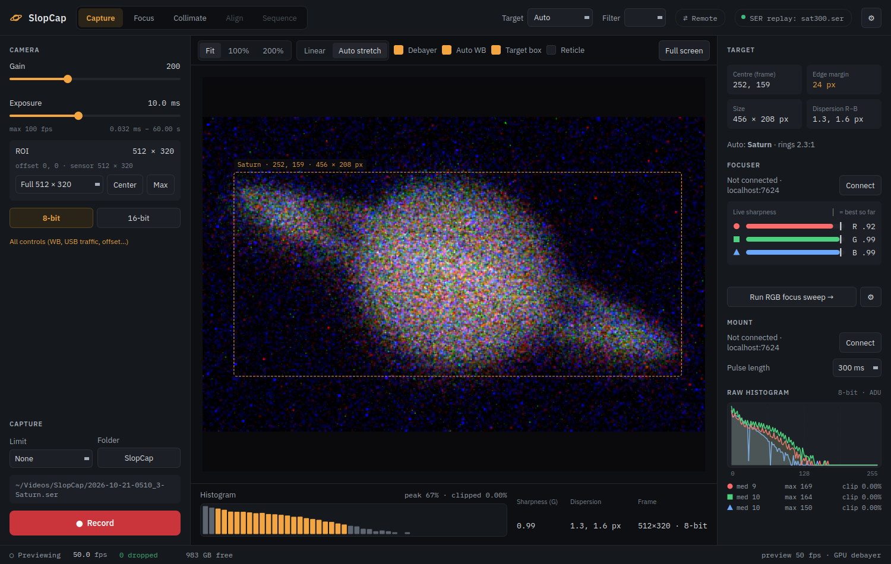

# A night at the telescope

This guide walks through a planetary night with SlopCap: connecting the camera, getting a good image, collimating,
focusing, and recording. It assumes a colour or mono astronomy camera (ZWO or QHY) and, optionally, an electronic
focuser and a mount that INDI can drive.

## The screen

- **Top bar:** the mode tabs (**Capture**, **Focus**, **Collimate**; *Align* and *Sequence* aren't finished yet), the
  **Target** and **Filter** for naming recordings, **⇄ Remote** for [remote viewing](remote-viewing.md), the
  **camera pill** (which camera is connected; click it to connect or disconnect), and the gear for Settings.
- **Left: the camera.** Gain and exposure, region of interest (ROI), 8 or 16 bit, readout mode, and the capture
  options with the big **Record** button at the bottom.
- **Middle: the live view.** The toolbar above it sets the zoom (Fit, 100 %, 200 %), the stretch (Linear or Auto),
  colour (Debayer, Auto WB) and overlays (Target box, Reticle), and has **Full screen**. Under it: the histogram, live
  sharpness and dispersion numbers, and the frame size.
- **Right: what the telescope is doing.** The target SlopCap thinks it sees, the focuser, the mount, and a raw
  histogram (the camera's real numbers, per colour channel, before any stretch).
- **Bottom bar:** frame rate at the camera, frames dropped (should stay at 0), recording speed and free disk space.

## 1. Connect the camera

Click the camera pill at the top right. The list shows every ZWO and QHY camera that's plugged in (`asi:0 ASI585MC`,
`qhy:0 QHY533M …`). Pick yours. SlopCap remembers the camera and its settings for next time.

No camera to hand? **Replay a recording…** in the same menu plays an existing `.ser` file as if it were a camera,
in real time. Everything below works on a replay, which is a good way to learn SlopCap indoors.

## 2. Get a good image

- **Exposure** is in milliseconds; short exposures (a few ms) freeze the seeing. The camera's maximum frame rate is
  shown under the slider.
- **Gain:** the buttons under the gain slider are the camera's own landmarks: **Unity** (one electron per step),
  **Low noise** (lowest read noise), **Max DR** (most dynamic range), **HCG** (where the high-conversion-gain mode
  switches on). They're a good place to start.
- **ROI:** a planet only fills a small part of the sensor. A smaller ROI (the size list, **Center**) means a faster
  frame rate and smaller files. Right-click the planet in the live view and choose **Centre ROI here** to move the ROI
  onto it.
- **8-bit or 16-bit:** 8-bit is faster and is fine for planets; 16-bit keeps the camera's full range (the Moon, the
  Sun, faint moons).
- **All controls…** has the rest: white balance, USB traffic, offset, and whatever else the camera offers.

Watch the histogram: the **clipped %** figure under it should be zero or close to it on the bright parts of the planet.
The live view's stretch doesn't change the recording; it's only for your eyes.

In the live view: the mouse wheel zooms, dragging pans, **F** fits the image to the window, **1** shows it pixel for
pixel, **C** toggles a crosshair.

## 3. Collimate (Collimate tab)

Do this on a bright star, before focusing, whenever the telescope has been moved or handled.

1. Put a bright star in the middle of the view and defocus until it's a ring 40–100 pixels across.
2. Tick **Analyse the live view.** SlopCap measures how far the shadow of the secondary mirror sits from the centre of
   the ring, as a percentage of the ring's radius, and draws an arrow.
3. Turn the secondary screw toward the arrow (the ring's thin side), a little at a time. Re-centre the star after
   each turn.
4. Stop when the offset is under 2 % (the dashed line on the chart), which is good for most Schmidt-Cassegrains.

## 4. Focus (Focus tab)

With an electronic focuser, SlopCap finds the best focus for each colour separately: on a colour camera the red,
green and blue images don't come to focus at exactly the same place, and SlopCap tells you by how much.

1. **Connect the focuser:** the Focuser panel's **Connect** uses the INDI server in Settings (normally
   `localhost:7624`). In Settings, set the focuser's **backlash** (about 600 steps for a Gemini EAF) and the direction
   every move should finish in, so that the final approach always takes up the slack the same way.
2. **Watch the live sharpness bars** (R, G, B) while you nudge the focuser with the ± step buttons; the tick on each
   bar is the best seen so far.
3. **Run a sweep:** **Run RGB focus sweep →** (or the Focus tab) opens the sweep. **Coarse ±1500** or **Fine ±350**
   sets the range around the current position (or set From, To, Step, frames per step and settle time yourself);
   then **Run sweep**. SlopCap moves the focuser through the range, scores every frame and fits a curve per colour.
4. **Read the result:** the chart shows sharpness against position for each colour; the table gives each colour's
   best position and how far it is from green. Choose what to focus on (**Green**, **Luminance-weighted**,
   **Balanced**, **Red** or **Blue**) and press **Go to**. Several sharpness measures are computed on the same frames;
   **Which metric is tightest** shows which one agreed with itself best on this sweep.

With the focal ratio and the focuser's microns per step entered in Settings → Optics, the chart also shows the
critical focus zone: how far you can be from perfect focus before it shows. Each sweep's numbers are saved as a CSV
file in the recording folder.

## 5. Name the target

The **Target** list names your recordings. Leave it on **Auto** and SlopCap works out what it's looking at from the
image and the clock: Saturn by its rings, the Moon by its shape at tonight's phase, Mars, Jupiter, Uranus and Neptune
by size, colour and how dark the edge of the disc is. It never asks the mount. The Target panel says what it decided
and why; when it can't decide, it says what's left ("Moon or Jupiter") and recordings are named "Target" until it can.

Two settings help it a lot: **Settings → Optics → Focal length** (with the camera's pixel size this gives the image
scale, so a planet's size in pixels means something) and **Settings → Site** (latitude and longitude, so it knows
what's above the horizon). South and west are negative.

Pick the target yourself when you know better; the name can't change during a recording either way. **Filter** adds
the filter to the file name (L, R, G, B, IR, CH4, UV): `2026-10-17-0315_4-L-Saturn.ser`.

## 6. Record

Press **Record** (Ctrl+R, Cmd+R on a Mac). Press again to stop, or set a **Limit** (30 s to 10 min) and SlopCap stops
by itself. Use **Folder…** to choose where recordings go.

Each recording is a SER video named like WinJUPOS expects, from the time at the middle of the recording and the
target: `2026-10-17-0315_4-Saturn.ser`. Next to it, a `.txt` file lists the camera settings, the focuser position and
the mount's coordinates. Every frame carries its own timestamp.

Keep an eye on **dropped** in the bottom bar. Frames dropped by the camera usually mean the USB link is busy (lower USB
traffic, or a smaller ROI); frames dropped by the disk mean the disk can't keep up (a faster disk or a smaller ROI).

## 7. The mount (optional)

With a mount driver running on the same INDI server as the focuser (for a Meade LX200, `indi_lx200classic`), the
**Mount** panel on the right shows where the telescope points. **N**, **E**, **W** and **S** send guide pulses of the
chosen length to nudge the planet back into the ROI; **Stop** halts every motion.

## Afterwards

- Stack the recordings as usual (AutoStakkert!, PSS…). The `.txt` files keep what you used.
- `slopcap-diag --png OUT/ *.ser` stacks the best frames of each recording and reports how good the optics and the
  night were: colour dispersion, edge sharpness per colour and side, halo, jitter.
- Every run of SlopCap writes a **session log** of the whole night; see [Files, settings and logs](files-and-logs.md).

## Keyboard and mouse

| Key | Does |
|---|---|
| Ctrl+R (Cmd+R) | start / stop recording |
| F11 (Mac: Ctrl+Cmd+F) | full view: the live view over the whole screen; Esc leaves |
| F | fit the image to the window |
| 1 | 100 %: one camera pixel per screen pixel |
| C | crosshair on / off |
| mouse wheel / drag | zoom / pan the live view |
| right-click | **Centre ROI here** |

## Starting SlopCap from a command line

Everything is in the window, but SlopCap can also be started ready to go, which is handy for scripts and shortcuts:

| Option | Does |
|---|---|
| `--camera SPEC` | connect at start: `asi`, `asi:1`, `qhy`, `sim:FILE.ser` (replay), `sim-loop:FILE.ser` (replay forever) |
| `--out DIR` | recording folder |
| `--record` | start recording as soon as the camera is connected |
| `--focuser HOST:PORT` | connect the focuser through this INDI server |
| `--tab capture` / `focus` / `collimate` | open on this tab |
| `--serve`, `--connect HOST` / `auto` | share the camera, or watch another SlopCap ([remote viewing](remote-viewing.md)) |
| `--fullscreen` | start in full view |
| `--window WxH` | window size |
